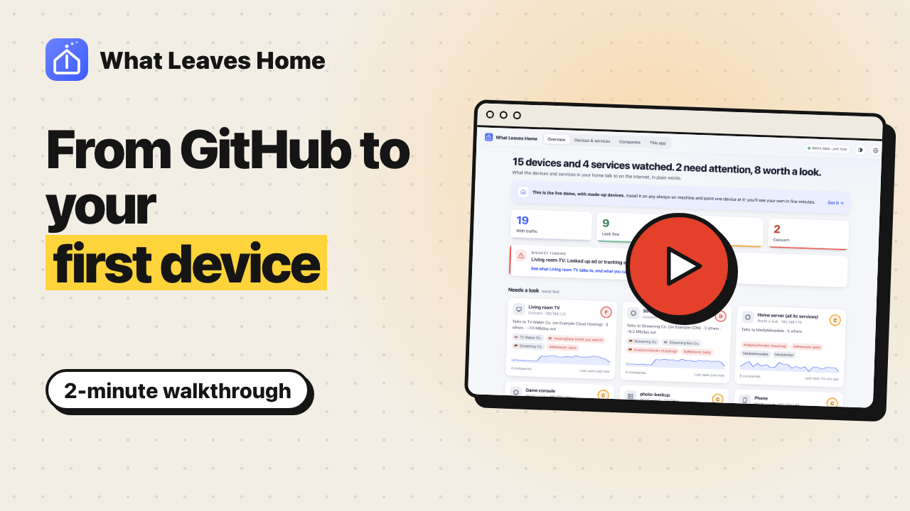
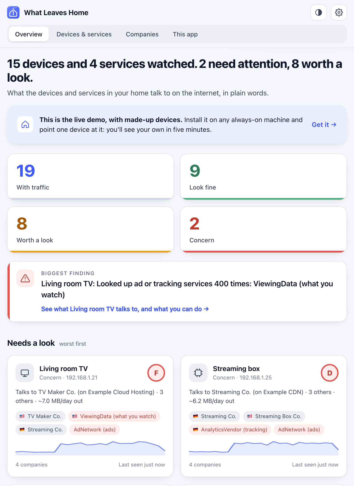
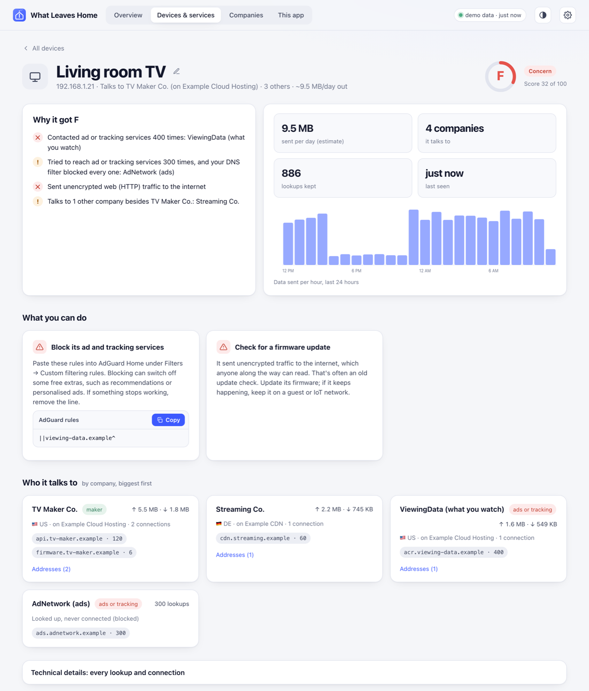
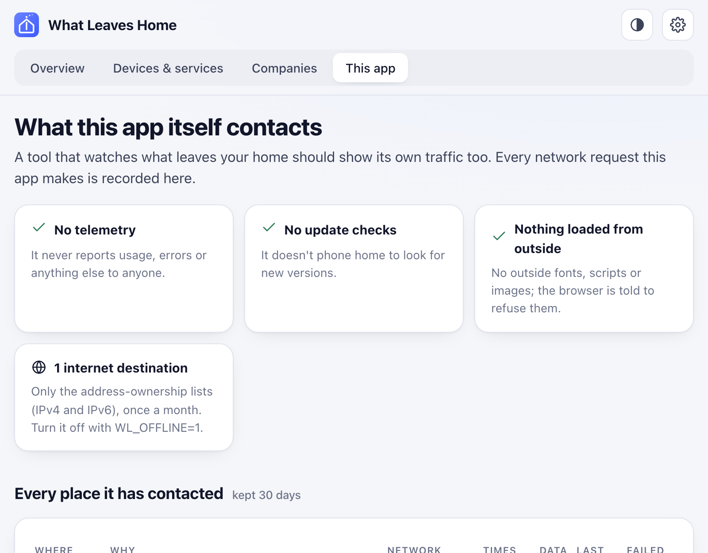

<p align="center">
  
</p>

<h1 align="center">What Leaves Home</h1>

<p align="center"><strong>See what every device in your home sends out.</strong></p>

<p align="center">
  <a href="https://github.com/swapanshridhar/what-leaves-home/actions/workflows/image.yml"></a>
  <a href="https://github.com/swapanshridhar/what-leaves-home/actions/workflows/pages.yml"></a>
  <a href="https://github.com/swapanshridhar/what-leaves-home/releases/latest"></a>
  <a href="LICENSE"></a>
  <a href="#privacy"></a>
</p>

<p align="center">
  <a href="https://swapanshridhar.github.io/what-leaves-home/walkthrough.html"></a>
  <br><sub><a href="https://swapanshridhar.github.io/what-leaves-home/walkthrough.html">Watch the 2-minute walkthrough</a>: from GitHub to your first device.</sub>
</p>

What Leaves Home shows what each device, and each app on your home servers, talks to on the internet: which companies, from which countries, how much data, and whether any of it is ads or tracking. It works on top of the AdGuard Home or Pi-hole you already run, changes nothing on your network, and keeps everything on your own machine.

Status: early (0.8). Grades are a first version: simple rules, always shown with their reasons.

**Three ways to start:**

| | What you'll see | What you need | Time |
|---|---|---|---|
| **[Look at the live demo](https://swapanshridhar.github.io/what-leaves-home/)** | Made-up devices | A browser | Now |
| **[Try it on your laptop](#try-it-on-your-laptop)** | This laptop | Docker Desktop (Mac, Windows or Linux) | 2 minutes |
| **[Run it for your whole home](#run-it-for-your-whole-home)** | Every device that uses your DNS filter | An always-on Linux machine with Docker (a Raspberry Pi, a NAS, a home server), and AdGuard Home or Pi-hole 6. No filter yet? It installs AdGuard Home for you | 10 minutes |

You can start on the laptop and move to a home server later.

<picture>
  <source media="(prefers-color-scheme: dark)" srcset="docs/screenshots/overview-dark.png">
  
</picture>

<sub>Screenshots are from the live demo, with made-up devices.</sub>

## What you get

- **A verdict per device, in plain words.** An A to F grade with the reasons ("Looked up ad or tracking services 400 times", "Every connection was encrypted", "Talks only to LG"), and the one finding worth looking at first.
- **Companies and countries, not IP addresses.** "LG, hosted on Amazon Web Services, US", with the exact names and addresses one click away. Destinations nothing looked up are still labelled by what they are ("Time server", "Encrypted messaging", "Tailscale relays").
- **What to do about it.** Ready-to-paste block rules for AdGuard Home or Pi-hole for the trackers that got through, plus a firmware or settings nudge where it fits. The overview gathers one block list for the whole home.
- **Your home servers, app by app.** A small agent on each server tells apart which container or service phones home to whom: Jellyfin, Home Assistant, the media apps, anything in Docker or systemd.
- **Honesty about itself.** A "This app" page lists every network request What Leaves Home makes. In normal use that's your DNS filter and a monthly download of a public address-ownership list (one file for IPv4, one for IPv6). No telemetry, no update checks, nothing loaded from outside.
- **Set-up that ends in a result.** A first-run guide ends with "point one device here" and shows it on screen as soon as it arrives. It spots when your router is hiding your devices, and explains the fix for your kind of router.

## How it's different

There are good tools near this space. What Leaves Home is built to be the layer they leave out:

- **Not another DNS dashboard.** DNS filter dashboards list raw lookups; this turns them into verdicts, companies and next steps, on top of the filter you already trust. It doesn't replace your DNS server.
- **Your traffic stays home.** Some tools in this area send what they collect to a server elsewhere for analysis. This one keeps everything on your machine, and shows you its own traffic to prove it.
- **No hardware to buy.** It runs on any always-on machine you already have (a Raspberry Pi, a NAS, an old PC, Home Assistant's host), unlike the paid boxes that do similar things.
- **Self-hosted apps, not just gadgets.** Per-service visibility on your own servers is the part people usually piece together from command-line tools. Here it's one command per server and a page per app.
- **Honest about limits.** DNS-based tools can't see devices that use hard-coded or encrypted DNS, or devices hidden behind a router that answers DNS for everyone. The app says when that's happening, and the agent's connection data fills some of the gap.

## Install

### Try it on your laptop

For a first look, on a Mac, Windows or Linux laptop with [Docker Desktop](https://www.docker.com/products/docker-desktop/) running. It brings its own AdGuard Home, already set up, so there's nothing to configure:

```bash
mkdir what-leaves-home && cd what-leaves-home
curl -fsSLO https://raw.githubusercontent.com/swapanshridhar/what-leaves-home/v0.8.1/compose.laptop.yaml
docker compose -f compose.laptop.yaml up -d
```

Open [http://localhost:8080](http://localhost:8080). There's no login: everything here listens on this laptop only, not on your network.

**To see your laptop's own traffic,** point its DNS at the AdGuard Home that just started, at `127.0.0.1`:

- **Mac:** System Settings → Wi-Fi → Details (next to your network) → DNS → **+** → `127.0.0.1`, remove the other entries, OK.
- **Windows:** Settings → Network & internet → Wi-Fi → your network's properties → DNS server assignment → Edit → Manual → IPv4 on → Preferred DNS `127.0.0.1` → Save.
- **Browsers with "secure DNS" turned on** skip it, so turn that off while you try: Chrome → Settings → Privacy and security → Security → Use secure DNS; Firefox → Settings → Privacy & Security → DNS over HTTPS.

Within a minute your laptop shows up as **This computer**, with its grade and who it talks to. AdGuard Home's own page is at [http://localhost:3000](http://localhost:3000).

**When you're done,** set the DNS back to automatic **first**, then remove it:

```bash
docker compose -f compose.laptop.yaml down -v
```

(Removing it while the DNS still says `127.0.0.1` leaves the laptop unable to look anything up, until you set the DNS back.)

### Run it for your whole home

On an always-on Linux machine with Docker on your home network: a Raspberry Pi, a NAS or a home server. Pick the line that fits.

**You already run AdGuard Home or Pi-hole 6:**

```bash
mkdir what-leaves-home && cd what-leaves-home
curl -fsSLO https://raw.githubusercontent.com/swapanshridhar/what-leaves-home/v0.8.1/compose.yaml
docker compose up -d
```

1. Open `http://<this machine's address>:8080` (`hostname -I` prints the address).
2. Create the login. There's no default password: the first visit asks for a one-time setup code, which `docker logs whatleaves` prints, so nobody else on your network can claim the page first.
3. Press **Connect**, choose AdGuard Home or Pi-hole, enter its address (the one you open its web page at) and its login, then **Test** and **Save**. For Pi-hole 6, use an app password from Settings → Web interface / API. (Pi-hole 5 isn't supported.)

**You don't run either yet:** this installs AdGuard Home together with What Leaves Home, already connected.

```bash
mkdir what-leaves-home && cd what-leaves-home
curl -fsSLO https://raw.githubusercontent.com/swapanshridhar/what-leaves-home/v0.8.1/compose.with-adguard.yaml
docker compose -f compose.with-adguard.yaml up -d
```

1. **Right away,** open `http://<this machine's address>:3000` and finish AdGuard Home's short setup: keep its web page on port 3000 and DNS on port 53, and choose its login. Until you do, anyone on your network could.
2. Open `http://<this machine's address>:8080` and create the login, with the setup code from `docker logs whatleaves`.
3. Point your devices at this machine (below). What Leaves Home reads AdGuard's log file, which AdGuard writes after about a thousand lookups, so the first results take a little while.

If port 53 is already in use on a Debian or Ubuntu machine, the system's own DNS stub is holding it. AdGuard's documentation describes the fix ("Docker: port 53 is in use"): turn off `DNSStubListener` in systemd-resolved.

**Either way:** if port 8080 is already taken on that machine, put `WL_HOST_PORT=8090` in a file named `.env` next to the compose file, run the `up -d` command again, and use port 8090. The same `.env` file can hold your AdGuard or Pi-hole details instead of entering them on the page; see [.env.example](.env.example). Some routers ship their own build of AdGuard Home that only accepts the router's admin session (GL.iNet is one): read its log file instead, as in [docs/collector.md](docs/collector.md).

**Coming from the laptop?** Install on the home server as above. The laptop's data stays on the laptop; remove it there with `down -v`, after setting its DNS back.

**Prefer the source?** `git clone https://github.com/swapanshridhar/what-leaves-home.git`, then `docker compose up -d --build` in it builds the image yourself.

## Point your devices at your filter

What Leaves Home is at its best when each device (the TV, the speaker, each phone) shows up separately. That happens when each device asks your DNS filter directly. The page's **See each device separately** guide walks through it for your router; in short:

1. **Change the DNS your router hands out.** In your router's DHCP or LAN settings, set the DNS server to your filter's address. Every device picks it up as it reconnects, and each shows up separately. Many standalone routers allow this, and OpenWrt, OPNsense, pfSense and UniFi always do.
2. **Set DNS on individual devices.** Phones, computers, most TVs and streaming boxes, and game consoles have a manual DNS setting. The app's **See each device separately** page gives the steps for each kind. Smart plugs, fans and appliances don't have one.
3. **A small helper router** (a travel router, about $30 to $120) gives a few appliances their own Wi-Fi with AdGuard as DNS.
4. **A router that hands out AdGuard**, for every device permanently.

### If you have Google Wifi, Nest Wifi or eero

These mesh systems always hand out *themselves* as the DNS server and forward lookups on. Setting a custom DNS server in their app (Google Home app → Wi-Fi → Settings → Advanced networking → DNS) only changes where the router forwards to. So AdGuard sees one client, the router, and What Leaves Home shows it as **"Everything behind your router"**: a whole-home view, but not device by device. The app spots this and opens the step-by-step guide.

To see devices separately with one of these:

- **No new hardware:** set DNS on the devices that matter most (option 2: phones, computers, TVs, consoles). Also give them the address for IPv6, or turn IPv6 off in the router's app, or some lookups still go through the router.
- **For appliances:** a helper travel router (option 3) for the ones near it.
- **For everything:** something else has to be the router (option 4). These meshes can't keep their extra points once they stop being the router: bridge mode works with a single unit only. So plan for access points that mesh in access-point mode, alongside the new router.

The whole-home view is the fallback while you decide. It's still useful for what the house as a whole talks to.

## Updating and removing

In the folder with the compose file:

```bash
docker compose pull && docker compose up -d   # update to the latest version, keeping your data
docker compose down                           # stop it; your data stays
docker compose down -v                        # remove it and its data
```

With the AdGuard Home or laptop versions, add `-f compose.with-adguard.yaml` or `-f compose.laptop.yaml` after `docker compose`. `down -v` there removes AdGuard Home's settings too. From a clone, update with `git pull && docker compose up -d --build`.

## Without Docker

Python 3.11 or newer, nothing to install:

```bash
WL_ADGUARD_URL=http://192.168.1.2:3000 WL_ADGUARD_USER=me WL_ADGUARD_PASSWORD=secret python3 -m whatleaves
```

or `WL_DEMO=1 python3 -m whatleaves` for the demo. It listens on port 8080 and keeps its data in `./data/`.

## Settings

All settings are environment variables, in `.env` when using Docker.

| Setting | What it does | Default |
|---|---|---|
| `WL_ADGUARD_URL` | AdGuard Home's address | |
| `WL_ADGUARD_USER`, `WL_ADGUARD_PASSWORD` | Its login. `WL_ADGUARD_PASSWORD_FILE` reads the password from a file instead | |
| `WL_PIHOLE_URL`, `WL_PIHOLE_PASSWORD` | Pi-hole 6 instead (app password). `WL_PIHOLE_PASSWORD_FILE` reads it from a file | |
| `WL_FILES_DIR` | Read collector files from this folder instead of the API ([docs/collector.md](docs/collector.md)) | |
| `WL_DEMO` | `1` shows demo devices | on when nothing else is set |
| `WL_NAMES` | Friendly names, like `192.168.1.20=Living room TV,192.168.1.21=Speaker` | names AdGuard knows |
| `WL_CLIENTS` | Only these addresses, comma-separated | all |
| `WL_USER`, `WL_PASSWORD` | Set the login in advance | created on the first visit, with the setup code from the log |
| `WL_AUTH` | `off` turns the login off (only behind your own sign-in; see Login) | on |
| `WL_ALLOWED_HOSTS` | Names you open the page by, if not an IP address, a one-word name (`raspberrypi`) or a `.local`, `.lan` or `.home.arpa` name. For example `whatleaves.example.org` | |
| `WL_TRUSTED_PROXIES` | Your reverse proxy's address, so the visitor address it passes on is believed | |
| `WL_OFFLINE` | `1`: never contact the internet (no ownership list) | off |
| `WL_INGEST_TOKEN` | The token agents send | made once, shown on the Services page |
| `WL_SCAN_TARGETS` | Private ranges to scan daily for listening services | off |
| `WL_KEEP_DAYS` | Days of data to keep | 30 |
| `WL_POLL_SECONDS` | How often to read the source | 300 |
| `WL_PORT`, `WL_HOST` | Where to listen | 8080, all addresses |
| `WL_DB` | Database file | `/data/whatleaves.db` in Docker |

## What the page shows

- **Overview**: how many devices look fine, are worth a look, or are a concern, the single biggest finding, a tile per device, and where your data goes by company.
- **Devices**: every device with its grade, searchable and filterable. Each device page has:
  - its grade (A to F) and **why**, in plain bullets, good points included
  - who it talks to, **by company and country** ("LG, hosted on Amazon Web Services, US"), with the exact names and addresses one click away
  - data sent and received, and a 24-hour activity chart
  - the raw lookups and connections under Technical details
- **What you can do**: on each device or service page, concrete next steps, such as ready-to-paste AdGuard rules for its ad and tracking services, or a nudge to update firmware. The overview collects every rule your home needs in one block list.
- **Companies**: everyone your devices talk to, and which devices.
- **This app**: every network request What Leaves Home itself has made (see Privacy).





Connections and data volumes need a source that records them, such as the collector in [docs/collector.md](docs/collector.md). AdGuard alone only knows lookups.

### How grades work

Every device starts at 100. Points come off for: ad or tracking services (blocked by your filter, or on a built-in list), using its own DNS server to go around your filter, unencrypted web traffic to the internet (certificate checks and "am I online?" checks, which are plain HTTP on every device, don't count), talking to companies other than its maker, connecting to addresses it never looked up, and uploading a lot. A is 90 and up and looks fine; B and C are worth a look; D and F are a concern. The reasons are always listed with the grade. This is a first version, and suggestions are welcome.

### Company names and countries

Names like `cloud.lgthinq.com` are matched to companies from a built-in list. Addresses are matched to the network that owns them using the free [iptoasn.com](https://iptoasn.com) tables for IPv4 and IPv6 (public domain), downloaded once a month and kept on your machine. Nothing is looked up online per address. Set `WL_OFFLINE=1` to never download them.

## Services on your home servers

Every app on one server shares its address, so the DNS log alone can't tell Jellyfin from Home Assistant. A small agent fixes that. Open **Devices & services → Services**: it suggests which machines look like servers, with the evidence (what's listening there, whether it downloads container images, which service sites it looks up), and shows one command to run on each, with your address and token filled in:

```bash
# With Docker: the published agent image, pinned to this version
docker run -d --name whatleaves-agent --restart unless-stopped --network host --pid host --cap-add SYS_PTRACE \
  -v /var/run/docker.sock:/var/run/docker.sock:ro -e WL_URL=http://<this app> -e WL_TOKEN=<token> \
  ghcr.io/swapanshridhar/what-leaves-home-agent:0.8.1

# Or as a system service (needs python3)
curl -fsSL --proto '=https' https://raw.githubusercontent.com/swapanshridhar/what-leaves-home/v0.8.1/whatleaves/static/install-agent.sh \
  | sudo WL_URL=http://<this app> WL_TOKEN=<token> sh
```

The agent reads the server's connection table and which program or container opened each connection, and sends that here every 5 minutes. It changes nothing; the system-service installer only turns on the kernel's per-connection byte counts and says so. Its code is one file, [whatleaves-agent.py](whatleaves/static/whatleaves-agent.py).

The agent runs as root, so its code never comes over plain HTTP. The installer comes from GitHub over HTTPS, pinned to a release. It runs the agent only if its SHA-256 matches the one written in the installer. The system service keeps only the permissions it needs to read connections. If you open What Leaves Home over HTTPS (behind your own reverse proxy), the commands fetch from it instead, with the same check. The token in the commands works like a password: if it leaks, make a new one on the Services page.

On a server whose kernel has no `/proc/net/nf_conntrack` (Raspberry Pi OS, for one), use the system service: it installs the `conntrack` tool, which the Docker image leaves out.

### Finding services by scanning (optional, off by default)

Set `WL_SCAN_TARGETS=192.168.1.0/24` and the app checks once a day for services listening on common ports, and reads their page titles. Only home ranges (10.x, 172.16–31.x, 192.168.x) up to 1024 addresses are accepted, and each scan is listed on the This app tab.

## Privacy

DNS logs are a record of what people and devices do. What Leaves Home:

- only reads; it changes nothing on your network or in AdGuard
- keeps its copy on the machine it runs on, for `WL_KEEP_DAYS` days
- keeps no access log, sends no telemetry and never checks for updates
- loads nothing from outside in your browser: no fonts, scripts or images from elsewhere
- records **every network request it makes itself** and shows them on the **This app** tab. In normal use that's AdGuard on your network and the monthly ownership lists. With `WL_OFFLINE=1` it never contacts the internet at all.

### Login

The first visit creates the login. It asks for a one-time setup code that the app prints to its log (`docker logs whatleaves`), so only whoever installed it can create the login, not some other device on the network that gets there first. Set the login in advance with `WL_USER` and `WL_PASSWORD` instead, if you prefer. Change the password under Settings. Don't expose it to the internet.

Behind a reverse proxy, add the name you open it by to `WL_ALLOWED_HOSTS`. The page only answers to addresses, one-word names and home names (`.local`, `.lan`, `.home.arpa`) by default, so a web page elsewhere can't reach it by pointing its own domain at your network. If the proxy already handles sign-in (with SSO), you can turn the login off with `WL_AUTH=off`. Then publish the port on `127.0.0.1` only (`"127.0.0.1:8080:8080"` in compose.yaml), so nobody can go around the proxy to reach it.

The database holds the login, the agent token and any AdGuard or Pi-hole password saved from the page, and only the app's own user can read it.

If you only care about appliances, set `WL_CLIENTS` so it never stores phones' and laptops' lookups.

## Development

```bash
python3 -m unittest discover -s tests -t .
WL_DEMO=1 WL_DB=/tmp/wl.db python3 -m whatleaves
```

Standard library only. The page is `whatleaves/static/`; the grading is `whatleaves/analysis.py`; companies and countries are `whatleaves/enrich.py`; every outbound request goes through `whatleaves/net.py`, and a test checks that nothing else opens a connection.

## Planned

- Better grades: device types, known trackers per device type, DNS that bypasses your filter
- Installing from the published image, without cloning the repository first

## How this was built

I designed What Leaves Home and ran it on my own home network while building it. Most of the code was written with Claude, an AI coding assistant, working to my direction. Every change is covered by the tests in this repository. Before the first public release, a separate AI review focused on security, and its findings were fixed. Bug reports and questions are welcome either way.

## Reporting a security problem

Please don't open a public issue. See [SECURITY.md](SECURITY.md).

## Licence

Apache License 2.0. See [LICENSE](LICENSE) and [NOTICE](NOTICE).
